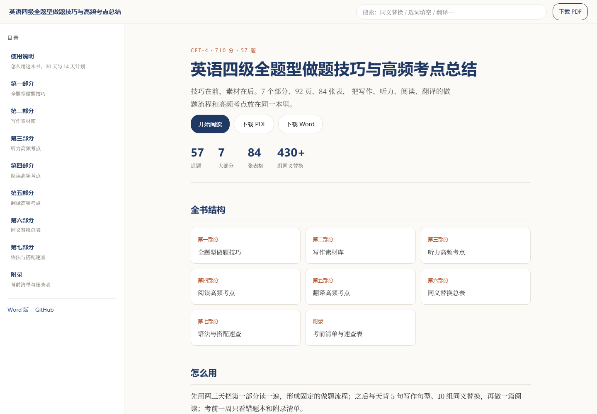

# 英语四级全题型做题技巧与高频考点总结

> 一本 92 页的四级备考手册：7 个部分、84 张表、430+ 组带中文注释的同义替换。
> 技巧在前，素材在后；网页、PDF、Word 三种形态同源。

**在线阅读**：https://1wozhenfule.github.io/cet4-guide/
**直接下载**：[PDF](assets/cet4-guide.pdf) · [Word](assets/cet4-guide.docx)



## 这本书里有什么

| 部分 | 内容 |
| --- | --- |
| 使用说明 | 30 天计划、14 天冲刺、三个本子、使用方法 |
| 第一部分 全题型技巧 | 分值结构与答题顺序、写作、听力、选词填空、长篇匹配、仔细阅读、翻译、分数策略 |
| 第二部分 写作素材库 | 六类作文框架、开头 20 句、主体功能句、结尾 15 句、高分语法结构 30 个、话题词伙、过渡词与 40 个副词、30 条名言、替换词表、4 篇范文点评、中式英语 30 例 |
| 第三部分 听力 | 语音现象、新闻/长对话/篇章技巧、15 类场景词、习语 100 条、同义替换 60 组、数字时间价格 |
| 第四部分 阅读 | 选词填空语法判定十则 + 高频词表、匹配题定位、仔细阅读六类题型与五种干扰项、长难句 20 例、同义词 120 组、同义短语 60 组、短语动词 71 个、易混词 36 组 |
| 第五部分 翻译 | 评分与四步法、常考话题、文化与国情词汇 180 个、中国特色表达 50 个、句式 41 个、短语 80 个、错误 20 例、5 段练习与参考译文 |
| 第六部分 同义替换总表 | 动词 62 组、名词 40 组、形容词副词 50 组、句式级替换 40 组、熟词僻义 44 个、构词法 |
| 第七部分 语法速查 | 时态、非谓语、定语从句、名词性从句、状语从句、虚拟、倒装强调、主谓一致、固定搭配 80 组 |
| 附录 | 考前 7 天清单、考场 10 条、易错拼写 30 个、不规则动词 24 个 |

## 几个特点

- **技巧在前**：第一部分把七个题型的做题流程固定下来，后面才是可背的素材。
- **表格优先**：能做成对照表的就不写长段落，方便扫读和遮住自测。
- **同义替换带中文**：4.6、4.7、6.1—6.3 等表格最后一列是中文释义，按替换词出现顺序一一对应。
- **翻译按话题组织**：文化词、成语、句式、常见错误、练习连成一条线。
- **范文带点评**：4 篇范文都标了"为什么这样写"，而不是只给一篇范文。

## 本地预览

不需要任何依赖，直接双击 `index.html` 即可（搜索功能也能用，索引通过 `assets/search-data.js` 加载）。

想用本地服务器预览：

```bash
python -m http.server 8000
# 打开 http://localhost:8000
```

## 重新生成

内容源在 `content/*.md`，改完运行：

```bash
python tools/build_site.py
```

脚本只依赖 Python 标准库，会重新生成所有 HTML、`search.json` 和搜索索引。

## 目录结构

```
.
├── index.html            # 首页
├── intro.html            # 使用说明
├── part1.html … part7.html
├── appendix.html
├── search.json           # 搜索索引（可选，供二次开发）
├── assets/
│   ├── style.css
│   ├── app.js
│   ├── search-data.js    # 搜索数据（JS 形式，file:// 也能用）
│   ├── cet4-guide.pdf
│   ├── cet4-guide.docx
│   └── preview.png
├── content/              # Markdown 源文件（唯一内容源）
├── tools/build_site.py   # 静态站点生成器
└── LICENSE
```

## 许可

除另有说明外，本仓库内容采用
[CC BY-NC-SA 4.0](https://creativecommons.org/licenses/by-nc-sa/4.0/deed.zh) 许可：

- **署名**：转载、引用请注明来源与本仓库链接。
- **非商业**：不得用于商业销售、付费课程、付费资料包等。
- **相同方式共享**：修改后的版本需以同样的许可发布。

如果你希望允许商用（例如自己上架销售），需要把 `LICENSE` 换成相应许可，或直接联系作者取得授权。

## 关于内容

- 本资料为**非官方**备考资料，按现行四级笔试题型整理，题型、分值、时间以官方考试大纲和当次准考证说明为准。
- 内容由 AI 辅助生成、人工整理与校对，可能存在疏漏；发现错误欢迎提 Issue。
- 书中的名言、谚语仅为简短引用并注明出处；考试题型与分值属于事实性信息。

## 贡献

欢迎提 Issue 纠错或提 PR 补充内容。纠错时请尽量写明"章节号 + 原文 + 建议改法"，方便快速定位。

如果这份资料帮到了你，点个 Star 就是最好的支持。